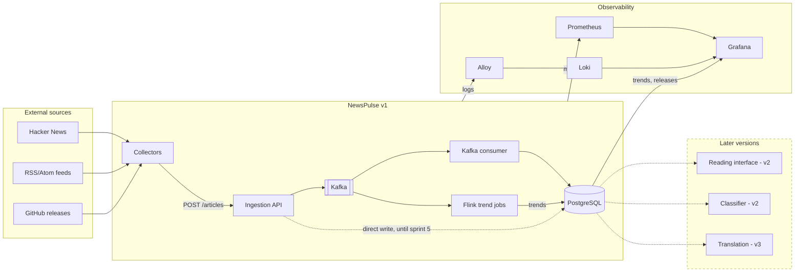

# Architecture diagram

Target architecture for v1 (sprints 0 to 8), with later versions shown as placeholders.

Notes:

- Until sprint 5, the ingestion API writes directly to PostgreSQL (dotted arrow). From sprint 5, articles go through Kafka (FR-09).
- The "Later versions" box is a placeholder: it shows where v2 and v3 plug in, without detailing them. It is updated at the end of each version.