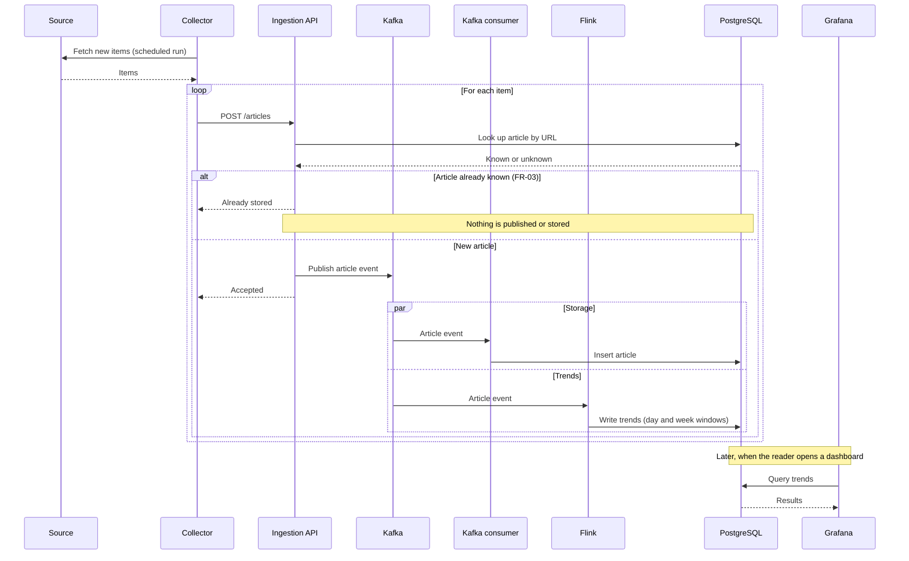

# Sequence diagram

Main flow of v1: from a source to a dashboard, including the duplicate case.

Notes:

- Until sprint 5, the API writes directly to PostgreSQL instead of publishing to Kafka.
- Grafana pulls data from PostgreSQL when a dashboard is opened; nothing is pushed to it.